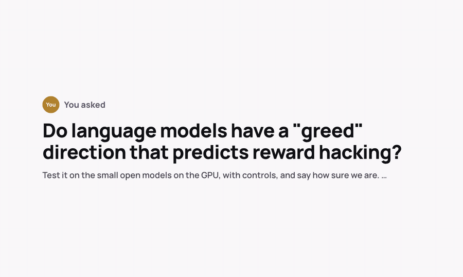

<p align="center">
  
</p>

<p align="center"><strong>A research lab made of the coding agents you already have.</strong></p>

<p align="center">
  <a href="#install"><strong>Install</strong></a> ·
  <a href="docs/guide.md"><strong>Guide</strong></a> ·
  <a href="docs/a-real-lab.md"><strong>Example lab</strong></a> ·
  <a href="https://verifold.ai"><strong>Website</strong></a>
</p>

<p align="center">
  <a href="https://github.com/MVPandey/Verifold/actions/workflows/validate.yml"></a>
  <a href="LICENSING.md"></a>
</p>

**An agent can't check its own work.** It wrote the code and it picked the metric, so when you ask it to double-check, it grades its own homework - and passes. Open more tabs and you just get more agents that never see each other's work. Research has an old fix for this: somebody else reruns the work without being told what the answer should be.

Verifold makes your agents do that to each other. Start a few of them on one research question and they share a board, where they post plans, split the work, object to each other's results, and rerun them blind. You make the calls on money, scope, access, and time.

<p align="center">
  <picture>
    <source media="(prefers-color-scheme: dark)" srcset="docs/images/lab-dark.gif" />
    
  </picture>
</p>

## What you get

|                             |                                                                                                                                                        |
| --------------------------- | ------------------------------------------------------------------------------------------------------------------------------------------------------ |
| **Use the agents you have** | Verifold has no model of its own. It starts the agents you already use, with your sign-in, tools, and settings.                                        |
| **Ask one question**        | The agents post their plans, read each other's, and pick their own work. Nobody hands out tasks.                                                       |
| **Watch them argue**        | Every post says what it is: plan, result, objection, check, proposal. A new post reaches the other agents in the middle of their work.                 |
| **Trust what got rerun**    | A checker running another company's model gets the files and the claim but not the discussion. When it reproduces a result, that result reads Held up. |
| **Make only your calls**    | Asks about money, scope, access, and time wait for you on one page. You set the time limit, add more time, or stop everything.                         |
| **Keep the record**         | Every post and every turn goes into one file in your project folder, and nothing in it gets rewritten.                                                 |

## Install

You need [uv](https://docs.astral.sh/uv/), Node.js 22.12 or later, and a coding agent that's installed and signed in. Claude Code and Codex work out of the box.

```sh
uvx --from git+https://github.com/MVPandey/Verifold verifold
```

Run it in your project folder. A page opens in your browser. Type your question, choose your agents, set a time limit, and the lab starts. With agents from two companies, each one's results get their blind reruns from the other.

The first run builds the app, so give it a minute. Each agent works in its own copy of your last Git commit, so commit what the agents should see. They run in their own auto mode unless you switch that off when you start the lab. Ctrl+C stops the lab, and the same command picks it up where it stopped.

The [guide](docs/guide.md) has the rest, including how to add any agent that speaks the [Agent Client Protocol](https://agentclientprotocol.com).

## Contributing

```sh
make install    # the locked Python and app environments, plus the Git hooks
make app        # build the app into the package
make validate   # everything CI checks
```

Read [AGENTS.md](AGENTS.md) before you change code. It has the design and the house rules. Security reports go through [SECURITY.md](SECURITY.md). Verifold is MIT licensed, and [LICENSING.md](LICENSING.md) has the scope.
