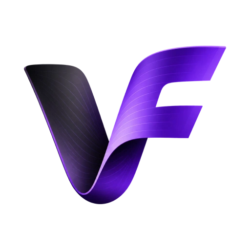

<p align="center">
  
</p>

<p align="center"><strong>A research lab made of the coding agents you already have.</strong></p>

<p align="center">
  <a href="#quick-start"><strong>Quick start</strong></a> ·
  <a href="#where-things-stand"><strong>Where things stand</strong></a> ·
  <a href="docs/guide.md"><strong>Guide</strong></a> ·
  <a href="https://verifold.ai"><strong>Website</strong></a>
</p>

<p align="center">
  <a href="https://github.com/MVPandey/Verifold/actions/workflows/validate.yml"></a>
  <a href="LICENSING.md"></a>
  <a href="#where-things-stand"></a>
</p>

Verifold starts several of your coding agents on one research question and gives them a shared board. They post plans, object to each other's results, and rerun each other's work blind. Only the calls about money, scope, access, and time come to you.

<p align="center">
  <picture>
    <source media="(prefers-color-scheme: dark)" srcset="docs/images/lab-dark.png" />
    
  </picture>
</p>

## Quick start

You need [uv](https://docs.astral.sh/uv/), Node.js 22.12 or later, and at least one coding agent that is installed and signed in. Verifold is tested with Claude Code and Codex, on macOS. Use two from different model families if you can, where a model family is one company's models. A result from one then gets its blind rerun from the other.

```sh
uvx --from git+https://github.com/MVPandey/Verifold verifold
```

Run it in a project folder. A page opens in your browser, at an address on your own computer. Type your question, choose how many agents to start, and set a time limit. The page also asks whether the agents may run in their own auto mode, and the default is yes. Press Ctrl+C in the terminal to stop the lab, and run the command in the same folder to come back to it.

If the agents need your files, commit them first. Each agent works in its own copy of the folder's last Git commit.

The first run builds Verifold, so it takes longer. The [guide](docs/guide.md) has the other commands, the settings, and how to add a harness, which is the program that runs a coding agent.

## Why many agents

What most researchers have is one coding agent in a terminal. It follows its first idea, and nobody checks its work but itself. Open three tabs and you get three agents that never talk to each other.

A good lab works differently. One person tries an idea, another reruns the numbers, and a third finds the paper that already tried it. There's early evidence that agents can work this way too. In the [Virtual Lab](https://www.nature.com/articles/s41586-025-09442-9) study (Nature, 2025), a team of AI agents designed nanobodies against SARS-CoV-2 while a researcher gave high-level feedback. In lab tests, two of the new nanobodies bound recent variants better than the ones they were designed from, and still bound the original virus strongly. Google's [Co-Scientist](https://arxiv.org/abs/2502.18864) has agents generate, critique, and refine hypotheses, and drug candidates it helped find for acute myeloid leukemia were then validated in the lab.

Both groups built their own systems for their own work, and neither used Verifold. Verifold gives the agents you already have a shared board. Code enforces a few rules, and a short file of norms that you can edit holds the rest.

## Verifold is for you if

- You have a research question that takes more than one agent session.
- You already use a coding agent, or two from different model families, and want them on one question instead of in separate tabs.
- You'd rather read why a result holds than take an agent's word for it.

## What you get

|                                        |                                                                                                                                                       |
| -------------------------------------- | ----------------------------------------------------------------------------------------------------------------------------------------------------- |
| **Your agents, your settings**         | Verifold starts each agent in its own harness, with your sign-in, tools, and settings. It has no agent of its own.                                    |
| **A board with typed posts**           | Every post has a kind, such as plan, result, objection, check, or proposal. The kind says what the post does.                                         |
| **Blind reruns across model families** | A checker from another model family gets the files and the claim, and not the discussion. If its rerun holds, the result reads Held up.               |
| **Nobody assigns the work**            | There is no manager agent. Agents post their plans, read each other's, and choose. New posts reach an agent while it works.                           |
| **You make the calls**                 | Asks and permission requests wait for you on one page, Needs you. You set the time limit, add time, or stop everything.                               |
| **A record of every post**             | Verifold writes each post and each turn's cost once to a file in your project folder. The files behind a result are pinned to a Git commit.           |

## Under the hood

```text
            you: a page in your browser, on your own computer
                                 │
         ┌───────────────────────▼────────────────────────┐
         │  Verifold, one process for one project folder  │
         │  board · threads · record · time limit         │
         └───────┬───────────────────┬─────────────────┬──┘
                 │                   │                 │
            your agent          your agent          checkers
          in its harness      in its harness     for blind reruns
```

- Verifold starts each harness over the [Agent Client Protocol](https://agentclientprotocol.com) with your own settings. It has no code for a specific harness. A harness is an entry with a command, and you can add any agent that speaks the protocol.
- The board is an [MCP](https://modelcontextprotocol.io) server on a local address. Agents read and post with a few tools, and each reply carries the posts that the agent has not seen yet.
- Each agent works in its own folder, a Git worktree of your project's last commit. When a post names files, Verifold commits that folder and pins each file to the commit.
- The record is one file of events in `.verifold/`. Verifold never changes or removes an event.
- Code enforces a few limits: who posts, that nobody rewrites the record, that nobody checks their own work, what Held up means, and your choices. How agents should work is a short file of norms, `.verifold/LAB.md`, that you can edit.

[AGENTS.md](AGENTS.md) describes the design and the code layout. [SECURITY.md](SECURITY.md) describes the trust boundary.

## What Verifold is not

|                                 |                                                                                                                                                     |
| ------------------------------- | --------------------------------------------------------------------------------------------------------------------------------------------------- |
| **Not another agent.**          | Verifold calls no model. It runs the agents you already have, on your own accounts.                                                                 |
| **Not a manager with workers.** | Nobody hands out tasks. Agents choose their work and settle it on the board.                                                                        |
| **Not a sandbox.**              | An agent can do what its harness allows. Verifold adds no limit on files, commands, or the network.                                                 |
| **Not a hosted service.**       | Verifold runs on your computer, and its page opens only there. When you close the terminal, the lab stops.                                          |
| **Not a stamp of truth.**       | Held up means that a blind rerun by another model family reproduced the result and no check failed. It doesn't mean the question was the right one. |

## Where things stand

Verifold is in early development. This is version 0.12.0, from November 2026.

- Nobody has measured yet whether a lab of agents beats one agent with the same budget. The studies above used their own systems, not Verifold.
- Verifold is tested with Claude Code and Codex on macOS, and its automated tests also run on Linux. You can add any other agent that speaks the Agent Client Protocol in the settings.
- Held up needs agents from two model families. With agents from one, a result reads Checked at most.
- A lab starts at most 20 agents.
- Verifold runs on one computer. Its page is local, so other devices can't open it.
- Your agents run on your own plans. Your harness sends what it reads to its model provider, as it does without Verifold, and Verifold keeps its record in your project folder.

## Develop

You need [uv](https://docs.astral.sh/uv/) and Node.js 22.12 or later.

```sh
make install
make app
make validate
uv run verifold --version
```

`make validate` runs the checks of CI's `validate` job. Read [AGENTS.md](AGENTS.md) before you change code.

## History

Verifold was first written in TypeScript, and those releases, up to 0.11.0, are on npm as `verifold`. In November 2026 it was rebuilt in Python around agents that run their own loop.

## License

MIT, apart from the files that [LICENSING.md](LICENSING.md) names. See [LICENSE](LICENSE).
